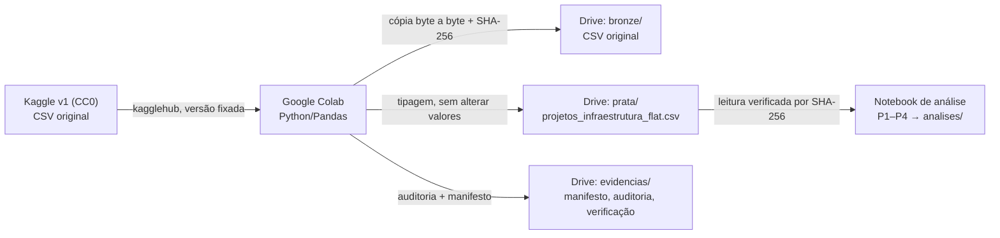
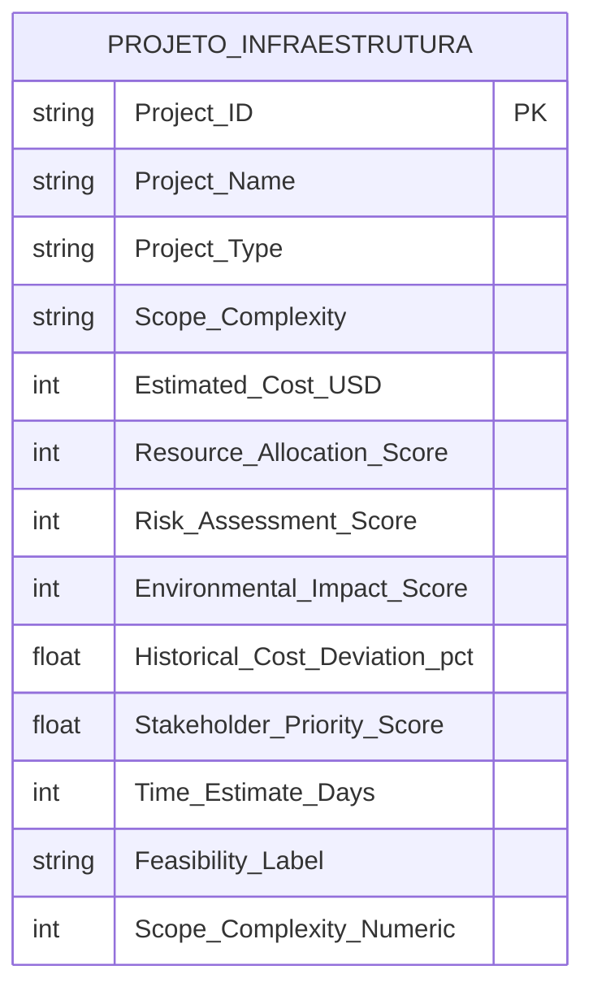

# Catálogo de Dados — PSP8 / MVP Viabilidade de Nova Unidade de Infraestrutura de Dados

Este catálogo descreve a tabela **prata** `projetos_infraestrutura_flat.csv` (modelo *flat*, um conceito: projeto de infraestrutura) e a sua linhagem desde o Kaggle. As regras de domínio abaixo são as mesmas aplicadas pelo código (`DOMINIOS` em [`scripts/pipeline_etl_drive.py`](../scripts/pipeline_etl_drive.py)).

> **Como ler as colunas "Domínio" e "Origem do domínio".** A fonte (Kaggle) **não publica dicionário de dados**: só cita grupos de atributos e as categorias do rótulo-alvo. Por isso cada domínio traz a origem da regra:
> `documentado_na_fonte` = citado na descrição do Kaggle · `observado_v1` = inferido dos dados da versão 1 · `convencao_do_projeto` = hipótese adotada neste trabalho (não é fato da fonte).
> As descrições marcadas *(inferida)* vêm do **nome** do atributo, não de documentação da fonte.

## 1. Fonte e linhagem do conjunto

| Item | Valor |
|---|---|
| Conjunto | *Engineering Project Cost Feasibility Dataset* — `ziya07/engineering-project-cost-feasibility-dataset` |
| URL | https://www.kaggle.com/datasets/ziya07/engineering-project-cost-feasibility-dataset |
| Autor / publicação | Ziya (`ziya07`); versão **1** ("Initial release"), atualizada em 2025-07-28T12:56:33Z |
| Licença | **CC0: Public Domain** (fonte: API pública do Kaggle, consultada em 2026-11-11; reconfirmar na página) |
| Arquivo original | `Engineering_Cost_Feasibility_Dataset.csv`, CSV UTF-8, 261.932 bytes, 3.245 linhas × 13 colunas |
| SHA-256 do CSV (v1) | `a93b9f10f889c95145dc5bdae9894a42582bb04c51b3bd1817ef515ff5920dc6` (igual na fonte, na bronze e na prata da execução no Colab) |
| Escopo dos dados | Projetos **genéricos de infraestrutura** (estradas, pontes, edifícios, usinas, obras hídricas) — **não** são uma amostra específica de data centers |
| Procedência | **Não documentada** pela fonte (origem e método de coleta não informados). Indícios de dados sintéticos são **hipótese**, não fato |
| Dados pessoais | Nenhum atributo identifica pessoas (apenas identificador de projeto, nomes genéricos de obra e escores) |

### Cadeia de transformação

| Camada | Pasta no Drive (`execucoes/<id>/`) | Conteúdo | Transformação |
|---|---|---|---|
| Bronze | `bronze/` | CSV original | Cópia byte a byte (SHA-256 igual ao da origem) |
| Prata | `prata/` | `projetos_infraestrutura_flat.csv`, 13 colunas, 3.245 linhas, mesma ordem | **Nenhuma alteração de conteúdo.** Texto lido como `string`, numéricos via `to_numeric` (erro se inválido). Sem imputação, deduplicação, padronização de chaves nem conversão de unidade. Na execução observada a prata é **idêntica à bronze byte a byte** |
| Evidências | `evidencias/` | `manifesto_execucao.json`, `auditoria_qualidade.json`, `verificacao_persistencia.json` | Geradas pelo código; registram hashes, tamanhos, versões, domínios e a releitura |
| Análises | `analises/` | CSVs e gráficos P1–P4 | Calculados a partir da prata relida |

Execução de referência da carga (manifesto no Drive): `20261111T004425Z_bc476d5a`, executada em 2026-11-11T00:44:25Z. Cada nova execução cria uma pasta própria, sem sobrescrever as anteriores.

## 2. Modelo de dados

Modelo **flat por conceito** (estilo *data lake*, em arquivos no Google Drive): uma única tabela, sem chaves estrangeiras. O Google Drive é usado como **armazenamento de arquivos**; não é um *data warehouse* nem um banco de dados gerenciado.

Chave natural: `Project_ID` (3.245 valores únicos na v1; `Project_Name` **não** identifica o projeto: só há 5 nomes).

## 3. Dicionário dos 13 atributos

Todos os atributos são **obrigatórios** na v1: 0 nulos em 3.245 registros. A fonte não define o que significaria uma ausência; o pipeline não imputa nem exclui valores.

| # | Atributo | Tipo (prata) | Descrição | Domínio de validação | Observado na v1 | Origem do domínio | Obrigatoriedade | Uso no MVP |
|---|---|---|---|---|---|---|---|---|
| 1 | `Project_ID` | texto (`string`), identificador | Identificador do projeto (*inferida*) | padrão `^P\d{4}$` | P0001 a P3245, 3.245 únicos | observado_v1 | Obrigatório; 0 nulos | Chave; não entra no índice |
| 2 | `Project_Name` | categórico (`string`) | Nome genérico do empreendimento (*inferida*); repete entre projetos | Dam Reinforcement, Industrial Complex, Highway Expansion, Smart Solar Grid, Urban Flyover | 5 categorias (679 / 659 / 651 / 633 / 623) | observado_v1 | Obrigatório; 0 nulos | Apenas auditado |
| 3 | `Project_Type` | categórico (`string`) | Tipo de obra (*inferida*) | Road, Power Plant, Building, Bridge, Water Infra | 5 categorias (689 / 649 / 641 / 638 / 628) | observado_v1 | Obrigatório; 0 nulos | Apenas auditado |
| 4 | `Scope_Complexity` | categórico ordinal (`string`) | Complexidade do escopo | Low, Medium, High | Medium 1.094 · High 1.088 · Low 1.063 | observado_v1 | Obrigatório; 0 nulos | Apenas auditado |
| 5 | `Estimated_Cost_USD` | numérico inteiro (`int64`), US$ | Custo estimado do projeto; unidade inferida do nome | > 0 (sem teto) | 1.000.404 a 6.998.223; mediana 3.994.200 | convencao_do_projeto | Obrigatório; 0 nulos | **Dimensão custo** do índice |
| 6 | `Resource_Allocation_Score` | numérico inteiro (`int64`), escore | Escore de alocação de recursos; escala não documentada | 0 a 100 (inteiro) | 50 a 99 | convencao_do_projeto | Obrigatório; 0 nulos | Apenas auditado |
| 7 | `Risk_Assessment_Score` | numérico inteiro (`int64`), escore | Escore de avaliação de risco. **Premissa do MVP:** valor maior = mais risco (a fonte não documenta o sentido) | 0 a 100 (inteiro) | 30 a 99; mediana 64 | convencao_do_projeto | Obrigatório; 0 nulos | **Dimensão risco** do índice |
| 8 | `Environmental_Impact_Score` | numérico inteiro (`int64`), escore | Escore de impacto ambiental; escala e sentido não documentados | 0 a 100 (inteiro) | 20 a 99 | convencao_do_projeto | Obrigatório; 0 nulos | Apenas auditado |
| 9 | `Historical_Cost_Deviation_%` | numérico decimal (`float64`), % | Desvio histórico em relação ao custo estimado (a fonte cita "historical deviation from estimated costs"); base de cálculo e sentido não documentados | ≥ 0 (hipótese: magnitude não negativa; sem teto) | 0,00 a 10,00; 950 valores distintos | convencao_do_projeto | Obrigatório; 0 nulos | Apenas auditado |
| 10 | `Stakeholder_Priority_Score` | numérico decimal (`float64`), fração | Prioridade atribuída pelas partes interessadas ("stakeholder priority levels" na fonte) | **0 a 1** (escala fracionária, **não 0–100**) | 0,50 a 1,00; 51 valores (passo 0,01) | observado_v1 | Obrigatório; 0 nulos | Apenas auditado |
| 11 | `Time_Estimate_Days` | numérico inteiro (`int64`), dias | Prazo estimado do projeto em dias; unidade inferida do nome | > 0 (sem teto) | 120 a 599; mediana 356 | convencao_do_projeto | Obrigatório; 0 nulos | **Dimensão prazo** do índice |
| 12 | `Feasibility_Label` | categórico (`string`), rótulo-alvo da fonte | Classificação final de viabilidade atribuída pela fonte ("final feasibility classification"); **critério de geração não documentado — não é verdade de campo** | Feasible, Not Feasible, Borderline | Feasible 1.931 · Not Feasible 823 · Borderline 491 | documentado_na_fonte | Obrigatório; 0 nulos | Comparado ao índice (P3); **não** entra no índice |
| 13 | `Scope_Complexity_Numeric` | numérico inteiro (`int64`), código ordinal | Codificação numérica de `Scope_Complexity`: Low = 1, Medium = 2, High = 3 | {1, 2, 3} | 1 a 3; mapeamento 1:1 sem exceções | observado_v1 | Obrigatório; 0 nulos | Apenas auditado |

### Regras de qualidade aplicadas a cada carga

Verificadas por [`auditar_prata`](../scripts/pipeline_etl_drive.py) e gravadas em `auditoria_qualidade.json`; **nenhum registro é removido ou alterado**:

- **Completude:** nulos e textos vazios por atributo. **Unicidade:** `Project_ID` e linhas duplicadas.
- **Conformidade:** domínio de validação acima (faixas numéricas, categorias, padrão do ID, números inteiros onde esperado).
- **Consistência:** `Scope_Complexity` × `Scope_Complexity_Numeric` (mapeamento Low/Medium/High → 1/2/3).
- **Acurácia (indícios):** *outliers* por 1,5×IQR, **apenas informativos**; valores fora do intervalo observado na v1.
- **Atualidade:** conjunto estático (versão 1, 2025-07-28), sem dimensão temporal; não há como avaliar defasagem dos valores.

Resultado na v1, reproduzido localmente sobre o mesmo CSV (SHA-256 igual ao do Colab): **0 violações** de domínio, 0 nulos, 0 duplicatas, 0 inconsistências de complexidade e 0 *outliers* por IQR. A auditoria registrada no Drive pela primeira execução no Colab confere nos itens que já existiam (nulos, duplicatas, mínimos, máximos, categorias e consistência de complexidade); as verificações de domínio e *outliers* entram nas execuções posteriores às correções da Etapa C.
